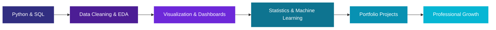

  

  

 

## 👩‍💻 About Me

> *Turning raw data into meaningful insights and building practical solutions with Python, SQL, and machine learning.*

I'm an **MCA student at Presidency University, Bengaluru**, with a **B.Sc. in Physics** and a strong interest in data analytics, Python development, and machine learning.

I enjoy exploring datasets, writing SQL queries, building visualizations, and developing end-to-end projects that solve practical problems. I'm continuously strengthening my technical skills through hands-on projects and experimentation.

|                             |                                                     |
| --------------------------- | --------------------------------------------------- |
| 🎯 **Career Interests**     | Data Analyst · Python Developer · Entry-Level AI/ML |
| 📊 **Core Focus**           | Python · SQL · Data Analysis · Data Visualization   |
| 🤖 **Exploring**            | Machine Learning · NLP · AI Applications            |
| 🌐 **Additional Interests** | Full-Stack Development · Mobile Applications        |
| 🔁 **My Approach**          | Learn → Analyze → Build → Evaluate → Improve        |

 

## 🛠️ Tech Stack

### 📊 Data Analytics & Visualization

* **Data Manipulation:** Pandas, NumPy
* **Data Visualization:** Matplotlib, Seaborn, Plotly, Chart.js
* **Data Analysis:** Data Cleaning, Exploratory Data Analysis (EDA), KPI Reporting
* **SQL:** Joins, Aggregations, Grouping, Relational Data Analysis

### 🤖 Machine Learning & NLP

* **Frameworks:** Scikit-learn, TensorFlow, Keras
* **Machine Learning:** Classification, Clustering, Model Evaluation
* **NLP:** Text Preprocessing, Sentiment Analysis, NLTK, VADER
* **AI Development:** Machine Learning Pipelines and AI-Powered Applications

### 🌐 Web & Application Development

* **Frontend:** HTML, CSS, JavaScript, React
* **Backend:** Node.js, Express.js, Flask, REST APIs
* **Mobile Development:** Flutter, Dart
* **Security:** JWT Authentication, Role-Based Access Control

### 🗄️ Databases, Cloud & Tools

* **Databases:** MySQL, MongoDB, SQLite, InfluxDB
* **Development Tools:** Git, GitHub, VS Code, Jupyter Notebook, Google Colab
* **Cloud & AI:** Google Cloud, Vertex AI
* **IoT & Messaging:** MQTT, Mosquitto

### 💻 Programming Languages

* Python
* Java
* C++
* JavaScript
* PHP

 

## 🚀 Featured Projects

<table>
<tr>
<td width="50%" valign="top">

### 📦 Blinkit Analytics Dashboard

**Data Analytics · SQL · Visualization**

An interactive analytics dashboard for exploring order performance, delivery efficiency, customer feedback, marketing performance, and inventory.

**Highlights**

* Analyzed 5,000 orders across eight relational tables.
* Developed nine SQL queries using validated join keys.
* Built a Python and Pandas pipeline for KPI calculations and visualizations.
* Developed a five-tab interactive dashboard using Chart.js.
* Analyzed delivery performance and marketing campaign ROAS.

**Reported Project Metrics**

* On-time delivery: 69.4%
* Marketing ROAS: 1.97

**Tech Stack**

`Python` `SQL` `Pandas` `Chart.js` `JavaScript`

[View Project Repository](https://github.com/sona-rajendren)

</td>
<td width="50%" valign="top">

### 🛡️ AI-Based DDoS Detection in IoT Networks

**Machine Learning · Cybersecurity · IoT**

A machine learning system designed to identify potential Distributed Denial-of-Service (DDoS) attacks in IoT network traffic.

**Highlights**

* Implemented Decision Tree, Naive Bayes, and Logistic Regression models.
* Integrated MQTT-based message collection using Mosquitto.
* Used InfluxDB for time-series data storage.
* Developed monitoring and alerting functionality.
* Explored federated learning for distributed model training.

**Tech Stack**

`Python` `Scikit-learn` `MQTT` `InfluxDB` `FastAPI` `Docker`

[View Project Repository](https://github.com/sona-rajendren)

</td>
</tr>

<tr>
<td width="50%" valign="top">

### 💊 PillGuard

**Full-Stack Development · Healthcare · AI**

A medication-monitoring application designed to support patients, caregivers, and doctors through web and mobile interfaces.

**Highlights**

* Built a React-based dashboard and Flutter mobile application.
* Developed REST APIs using Express.js and Node.js.
* Integrated MongoDB for data persistence.
* Implemented JWT authentication and role-based access control.
* Developed scheduled monitoring for overdue medication doses.
* Explored AI-assisted pill identification.

**Tech Stack**

`MongoDB` `Express.js` `React` `Node.js` `Flutter`

[View Project Repository](https://github.com/sona-rajendren)

</td>
<td width="50%" valign="top">

### 🌍 Multilingual Sentiment Analyzer

**Natural Language Processing · Machine Learning**

An NLP project focused on text preprocessing and sentiment classification for multilingual text.

**Highlights**

* Cleaned and preprocessed textual data.
* Explored sentiment classification techniques.
* Applied NLP methods to text analysis.
* Explored multilingual sentiment analysis.

**Tech Stack**

`Python` `NLTK` `VADER`

[View Project Repository](https://github.com/sona-rajendren)

</td>
</tr>
</table>

 

## 🎓 Education

| Degree                                     | Institution                      | Duration  |
| ------------------------------------------ | -------------------------------- | --------- |
| **Master of Computer Applications (MCA)**  | Presidency University, Bengaluru | 2025–2027 |
| **Bachelor of Science (B.Sc.) in Physics** | Kannur University, Kerala        | 2021–2024 |

 

## 🏆 Certifications & Achievements

* ☁️ **Google Cloud Skills Boost** — Prompt Design in Vertex AI
* ☁️ **Google Cloud Skills Boost** — Inspect Rich Documents with Gemini Multimodality and Multimodal RAG
* 📘 **NPTEL** — Knowledge Management
* 🥇 **PromptWars × Gen AI Club Hackathon** — Developed ScamGuard Pro

 

## 🧭 Learning Roadmap

 

## 📈 GitHub Stats

  

 

## 📬 Let's Connect

  

**✨ Turning Data Into Insights. Turning Ideas Into Solutions. ✨**

